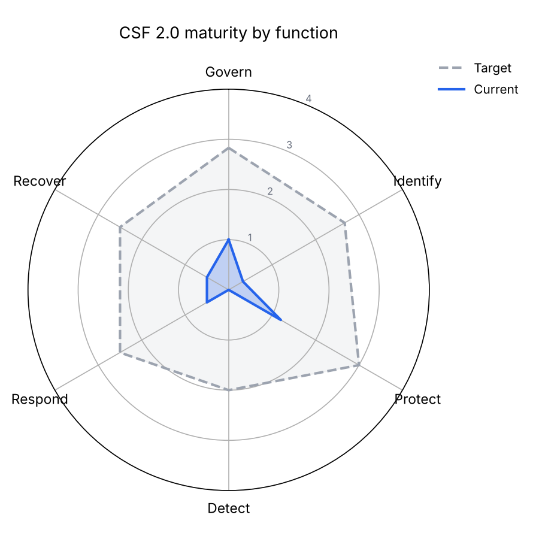
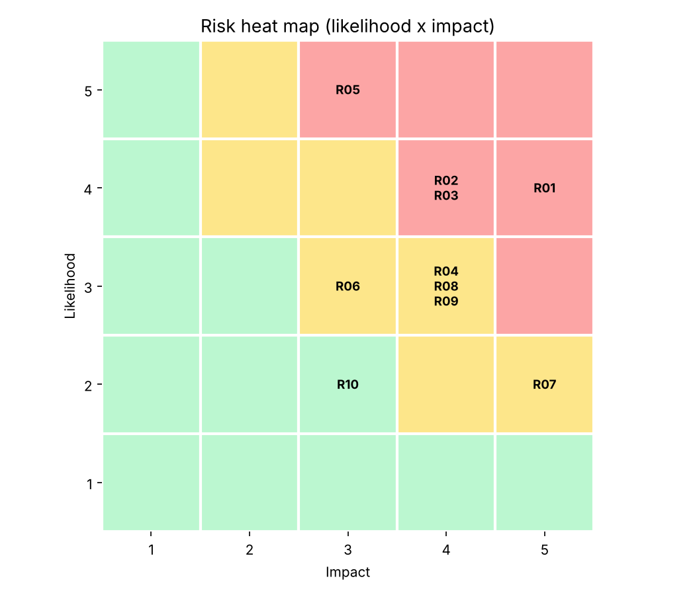

# NIST CSF 2.0 Risk Assessment


A Python tool that scores an organization against the 22 categories of the **NIST Cybersecurity Framework (CSF) 2.0**, builds a likelihood x impact risk register, ranks which gaps to fix first, and writes a report with charts.

The repo includes a full sample assessment of **Blue Ridge Family Dental**, a fictional 25-person dental practice with two offices, patient records covered by HIPAA, a cloud practice management system, and no in-house IT. Small offices like this are a common ransomware target, and they're the kind of place a new analyst might actually be asked to assess.

**[Read the sample report](reports/assessment_report.md)**

| Maturity by function | Risk heat map |
|---|---|
|  |  |

## What the sample assessment found

- Overall maturity is **0.73 out of 4** against a target of 2.68. **Detect** scores 0: nobody looks at logs or alerts.
- **4 of 10 risks are High.** The top one is ransomware, because the only backup is a USB drive that stays plugged into the network and a restore has never been tested.
- The top priority gap is **PR.AA (identity and access control)**. The front desk shares one login and email has no MFA, and three different risks depend on fixing that.
- The X-ray imaging PC runs Windows 10 with updates turned off and sits on the same network as the guest Wi-Fi.

## How it works

1. **Score each CSF category** in `data/assessment.csv` with a current and a target maturity from 0 to 4, plus a note on what was observed.
2. **List risks** in `data/risks.csv` with a likelihood (1-5), an impact (1-5), the CSF categories each one depends on, and a recommendation.
3. **Run the tool.** It averages each function, scores each risk as likelihood x impact, and ranks the gaps:

   ```
   priority = gap x (1 + risk exposure / 10)
   ```

   Risk exposure is the total score of every risk linked to that category. Two categories can have the same gap, but if ransomware, phishing and account takeover all depend on one of them, that one should get fixed first.
4. **Read the report.** You get a Markdown report with a summary, function scores, the risk register, priority gaps, recommendations, and the notes for every category, plus two PNG charts.

### Maturity scale

This is the project's own per-category scale. It is separate from the CSF "Tiers", which describe an organization's overall approach.

| Score | Meaning |
|---|---|
| 0 | Not performed |
| 1 | Ad hoc |
| 2 | Partially documented |
| 3 | Implemented and consistent |
| 4 | Measured and improving |

### Risk rating

| Score (L x I) | Rating |
|---|---|
| 15-25 | High |
| 8-14 | Medium |
| 1-7 | Low |

## Quick start

```bash
git clone https://github.com/clint-caccia/nist-csf-risk-assessment.git
cd nist-csf-risk-assessment
pip install -r requirements.txt

python assess.py --org "Blue Ridge Family Dental (fictional)"
```

```
Overall maturity 0.73 / 4 (target 2.68)
  Govern    current 1.0  target 2.83 gap 1.83
  Identify  current 0.33 target 2.67 gap 2.33
  Protect   current 1.2  target 3.0  gap 1.8
  Detect    current 0.0  target 2.0  gap 2.0
  Respond   current 0.5  target 2.5  gap 2.0
  Recover   current 0.5  target 2.5  gap 2.0
Top 3 priority gaps:
  PR.AA  Identity Management, Authentication, and Access Control (priority 10.0)
  PR.AT  Awareness and Training (priority 9.2)
  DE.CM  Continuous Monitoring (priority 8.4)
Report written to reports/assessment_report.md
```

To assess a different organization, copy the two CSV files in `data/`, fill them in, and point the tool at them:

```bash
python assess.py --assessment my_assessment.csv --risks my_risks.csv --org "My Org" --out my_report
```

The tool checks the inputs and stops with a clear error if a score is out of range or a category ID doesn't exist.

## Project layout

```
nist-csf-risk-assessment/
├── assess.py                 # command line entry point
├── csf_assess/
│   ├── model.py              # CSV loading, Category and Risk classes, validation
│   ├── analysis.py           # function scores, gap ranking, heat map grid
│   ├── charts.py             # radar chart and heat map (matplotlib)
│   └── report.py             # Markdown report
├── data/
│   ├── csf_categories.csv    # the 6 functions and 22 categories of CSF 2.0
│   ├── assessment.csv        # sample scores and observations
│   └── risks.csv             # sample risk register
├── reports/                  # generated sample report and charts
└── tests/
```

## Tests

```bash
pip install -r requirements-dev.txt
python -m pytest -v
```

The tests check the framework data (6 functions, 22 categories), risk scoring cutoffs, function averages, the gap ranking, the heat map, and that bad input gets rejected. GitHub Actions runs them on every push.

## Related projects

The Detect function scored 0 in this assessment, and email account takeover (R02) is one of the top risks. Two of my other projects are small examples of controls that would help:

- [auth-log-analyzer](https://github.com/clint-caccia/auth-log-analyzer): a DE.CM / DE.AE control that reads Linux login logs and flags brute force and suspicious logins.
- [phishing-email-analyzer](https://github.com/clint-caccia/phishing-email-analyzer): scores reported emails for phishing red flags and pulls out IOCs, which supports PR.AT awareness and DE.AE triage.

## Limitations

- Scores are a judgment call based on interviews and observation, not an audit. The value is in the notes and the ranking, not the decimals.
- It works at the category level. CSF 2.0 also has 106 subcategories, which a deeper assessment would score.
- Likelihood and impact are qualitative. A quantitative model like FAIR would put dollar amounts on each risk.

## References

- [NIST Cybersecurity Framework 2.0](https://www.nist.gov/cyberframework)
- [HHS HIPAA Security Rule guidance](https://www.hhs.gov/hipaa/for-professionals/security/index.html)

## Author

**Clint Caccia**, Computer Information Systems, James Madison University
[LinkedIn](https://www.linkedin.com/in/clint-caccia-b70428354) · [GitHub](https://github.com/clint-caccia)
