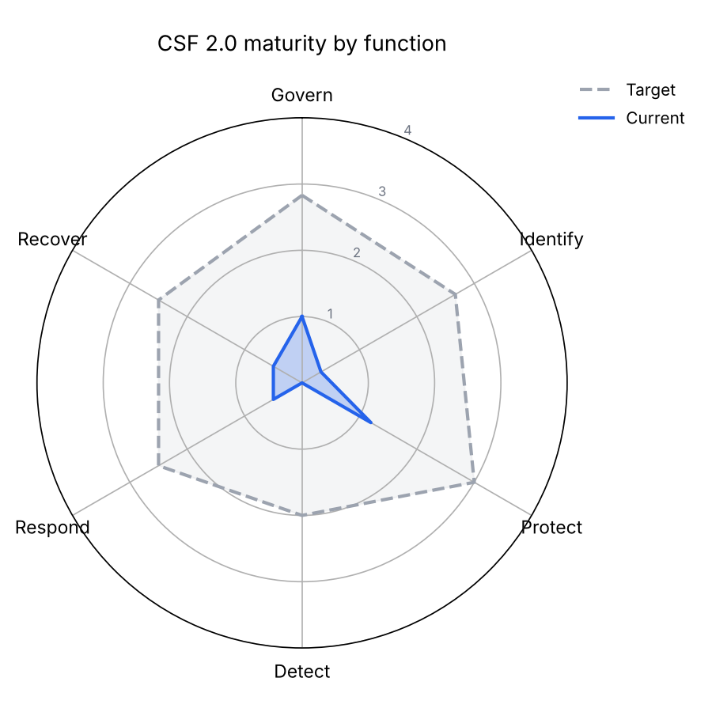
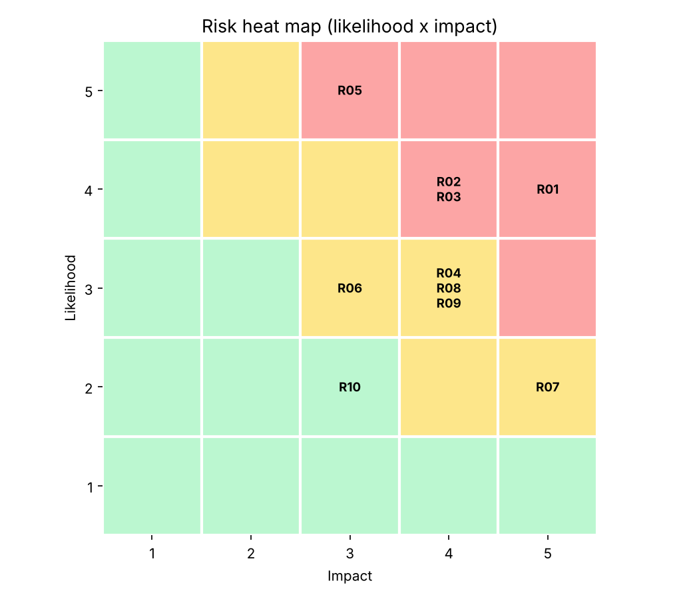

# NIST CSF 2.0 Risk Assessment: Blue Ridge Family Dental (fictional)

_Generated 2026-11-25 by csf-assess_

## Summary

Overall maturity is **0.73 out of 4** against a target of **2.68**. Of the 10 risks in the register, **4 are rated High**.

The weakest function is **Detect** (0.0). The top priority gap is **PR.AA Identity Management, Authentication, and Access Control**.

## Maturity by function

| Function | Current | Target | Gap | |
|---|---|---|---|---|
| Govern (GV) | 1.0 | 2.83 | 1.83 | `█████░░░░░░░░░░░░░░░` |
| Identify (ID) | 0.33 | 2.67 | 2.33 | `██░░░░░░░░░░░░░░░░░░` |
| Protect (PR) | 1.2 | 3.0 | 1.8 | `██████░░░░░░░░░░░░░░` |
| Detect (DE) | 0.0 | 2.0 | 2.0 | `░░░░░░░░░░░░░░░░░░░░` |
| Respond (RS) | 0.5 | 2.5 | 2.0 | `██░░░░░░░░░░░░░░░░░░` |
| Recover (RC) | 0.5 | 2.5 | 2.0 | `██░░░░░░░░░░░░░░░░░░` |

Scale: 0 = Not performed, 1 = Ad hoc, 2 = Partially documented, 3 = Implemented and consistent, 4 = Measured and improving.

## Risk register

| ID | Risk | L | I | Score | Rating | CSF categories | Treatment |
|---|---|---|---|---|---|---|---|
| R01 | Ransomware on office PCs | 4 | 5 | 20 | High | PR.DS, RC.RP, PR.AT, DE.CM | Mitigate |
| R02 | Email account takeover | 4 | 4 | 16 | High | PR.AA, PR.AT | Mitigate |
| R03 | Unpatched imaging PC | 4 | 4 | 16 | High | PR.PS, PR.IR, ID.AM | Mitigate |
| R05 | Shared front desk login | 5 | 3 | 15 | High | PR.AA, GV.PO | Mitigate |
| R04 | Lost or stolen laptop | 3 | 4 | 12 | Medium | PR.DS, ID.AM | Mitigate |
| R08 | Breach goes unnoticed | 3 | 4 | 12 | Medium | DE.CM, DE.AE | Mitigate |
| R09 | Disorganized incident response | 3 | 4 | 12 | Medium | RS.MA, RS.CO, RC.CO | Mitigate |
| R07 | MSP or vendor compromise | 2 | 5 | 10 | Medium | GV.SC, GV.OV | Mitigate |
| R06 | Former employee access | 3 | 3 | 9 | Medium | PR.AA, GV.RR | Mitigate |
| R10 | Internet outage | 2 | 3 | 6 | Low | PR.IR, RC.RP | Accept |

Likelihood and impact are each scored 1 to 5. Score = L x I. High is 15 or more, Medium is 8 to 14, Low is under 8.

## Priority gaps

Ranked by `gap x (1 + linked risk exposure / 10)`, so gaps that many serious risks depend on come first.

| Rank | Category | Function | Current | Target | Risk exposure | Priority |
|---|---|---|---|---|---|---|
| 1 | PR.AA Identity Management, Authentication, and Access Control | Protect | 1 | 3 | 40 | 10.0 |
| 2 | PR.AT Awareness and Training | Protect | 1 | 3 | 36 | 9.2 |
| 3 | DE.CM Continuous Monitoring | Detect | 0 | 2 | 32 | 8.4 |
| 4 | ID.AM Asset Management | Identify | 1 | 3 | 28 | 7.6 |
| 5 | RC.RP Incident Recovery Plan Execution | Recover | 1 | 3 | 26 | 7.2 |
| 6 | RS.MA Incident Management | Respond | 0 | 3 | 12 | 6.6 |
| 7 | PR.IR Technology Infrastructure Resilience | Protect | 1 | 3 | 22 | 6.4 |
| 8 | PR.PS Platform Security | Protect | 1 | 3 | 16 | 5.2 |

## Recommendations

In order of risk score:

- **R01 Ransomware on office PCs** (High, 20): Keep one backup copy offline or in immutable cloud storage, test a restore every quarter, and turn on antivirus alert forwarding to the MSP.
- **R02 Email account takeover** (High, 16): Turn on MFA for every email account and run phishing awareness training twice a year.
- **R03 Unpatched imaging PC** (High, 16): Put the imaging PC on its own network segment, ask the imaging vendor for a supported OS path, and add it to the asset inventory.
- **R05 Shared front desk login** (High, 15): Give each staff member their own login and write a short password and access policy.
- **R04 Lost or stolen laptop** (Medium, 12): Turn on BitLocker for all laptops and stop saving patient files locally.
- **R08 Breach goes unnoticed** (Medium, 12): Send firewall, sign-in and antivirus alerts to the MSP and review a weekly summary. Tools like a simple auth log analyzer can automate the first pass.
- **R09 Disorganized incident response** (Medium, 12): Write a one-page incident response plan with contacts, first steps, and HIPAA notification requirements, then run a tabletop exercise once a year.
- **R07 MSP or vendor compromise** (Medium, 10): Ask both vendors for security documentation, add security terms to the MSP contract, and require MFA on the MSP's remote access.
- **R06 Former employee access** (Medium, 9): Add account removal to the offboarding checklist and review active accounts every quarter.

Accepted risks: R10 Internet outage (Accept for now. Keep a printed day schedule as a fallback and revisit a backup connection next budget cycle.)

## Category detail

| Category | Current | Target | Observations |
|---|---|---|---|
| GV.OC Organizational Context | 2 | 3 | Owner knows patient records are the most important data and that HIPAA applies. Not written down anywhere. |
| GV.RM Risk Management Strategy | 1 | 3 | No stated risk appetite. Security spending is decided case by case when something breaks. |
| GV.RR Roles, Responsibilities, and Authorities | 1 | 3 | The office manager handles IT issues on top of her regular job. The MSP contract doesn't say who owns security decisions. |
| GV.PO Policy | 1 | 3 | Has a HIPAA privacy policy from a template. No acceptable use or password policy. |
| GV.OV Oversight | 0 | 2 | Nobody reviews security status. No reporting from the MSP. |
| GV.SC Cybersecurity Supply Chain Risk Management | 1 | 3 | Depends on a cloud practice management vendor and an MSP. No review of their security or contract terms. |
| ID.AM Asset Management | 1 | 3 | No inventory. Staff estimate 18 PCs and 4 laptops. The X-ray imaging PC is not tracked by the MSP. |
| ID.RA Risk Assessment | 0 | 3 | No risk assessment has ever been done. This project is the first. |
| ID.IM Improvement | 0 | 2 | No lessons-learned process. |
| PR.AA Identity Management, Authentication, and Access Control | 1 | 3 | Front desk shares one login. Email has no MFA. Former employees' accounts are not always disabled. |
| PR.AT Awareness and Training | 1 | 3 | One HIPAA training video at hire. No phishing training. |
| PR.DS Data Security | 2 | 3 | Practice management data is in the vendor's cloud. Laptops are not encrypted. Local backups go to a USB drive in the server closet. |
| PR.PS Platform Security | 1 | 3 | Most PCs get Windows updates. The imaging PC runs Windows 10 with updates turned off so the imaging software keeps working. |
| PR.IR Technology Infrastructure Resilience | 1 | 3 | Guest Wi-Fi and office PCs share the same network. One internet connection with no failover. |
| DE.CM Continuous Monitoring | 0 | 2 | No log collection. Antivirus is installed but alerts go to an inbox nobody checks. |
| DE.AE Adverse Event Analysis | 0 | 2 | No one looks at login or firewall events. |
| RS.MA Incident Management | 0 | 3 | No incident response plan. Staff would call the MSP and hope. |
| RS.AN Incident Analysis | 0 | 2 | No ability to figure out what happened after an incident. |
| RS.CO Incident Response Reporting and Communication | 1 | 3 | Owner knows breaches must be reported but doesn't know the HIPAA breach notification steps or deadlines. |
| RS.MI Incident Mitigation | 1 | 2 | MSP can reimage a PC. No documented containment steps. |
| RC.RP Incident Recovery Plan Execution | 1 | 3 | Backups exist but a restore has never been tested. |
| RC.CO Incident Recovery Communication | 0 | 2 | No plan for telling patients or staff during an outage. |
